# Joey

**Converte file. Tutto qui, davvero.**

🇬🇧 [Read in English](README.md)

Joey è un convertitore di file per Linux, gratuito e open source. Selezioni i file, premi un tasto, scegli il formato: fatto. Il risultato finisce accanto all'originale, che non viene mai toccato. Tutto avviene sul tuo computer: nulla viene caricato online.

<p align="center">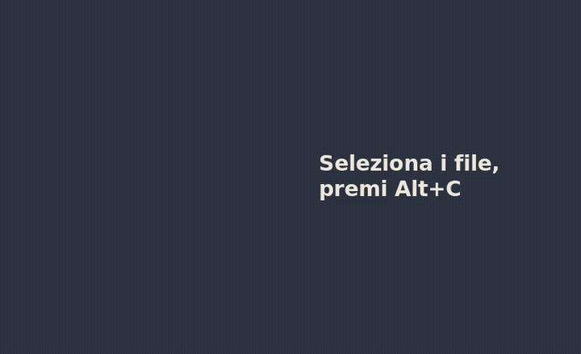</p>

> Stato: versione attuale (26.10.3). Funziona dall'inizio alla fine; le rifiniture arrivano dopo.
>
> **Fatto con l'AI:** Joey è scritto con un assistente AI. Vedi [Come è fatto Joey](#come-è-fatto-joey).
>
> Le versioni sono numerate per data: **anno.mese.uscita del mese** (26.10.2 è la seconda uscita di ottobre 2026). Non c'è un calendario fisso: gli aggiornamenti escono quando servono.

**Indice:** [Come aprirlo](#due-modi-per-aprire-joey) · [Installazione](#installazione) · [Convertire](#convertire) · [Più file insieme](#più-file-insieme) · [Regola](#regola-qualità-dimensioni-audio) · [Strumenti rapidi](#strumenti-rapidi) · [Azioni sui file](#azioni-sui-file) · [Invio a telefono o PC](#invio-al-telefono-o-al-pc) · [Da PDF a Excel](#da-pdf-a-excel) · [Tastiera, mouse, touch](#tastiera-mouse-e-touch) · [Codici di errore](#quando-qualcosa-va-storto-codici-di-errore) · [Segnalazioni](#feedback-e-segnalazioni) · [Usare Joey da un'AI](#usare-joey-da-unai) · [Riga di comando](#riga-di-comando) · [Problemi comuni](#problemi-comuni)

## Due modi per aprire Joey

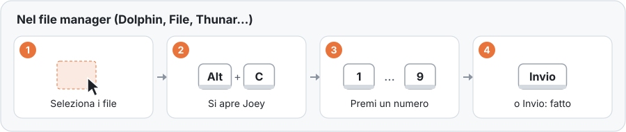

**Nel file manager:** seleziona i file, premi **Alt+C** (oppure tasto destro → *Joey*), poi premi un numero. Alt+C funziona in **Dolphin** 26.04 o successivo (KDE), **File/Nautilus** (GNOME) e **Thunar** (Xfce). **Nemo** (Cinnamon), **Caja** (MATE), **PCManFM** e **PCManFM-Qt** (LXDE/LXQt) hanno la voce nel tasto destro.

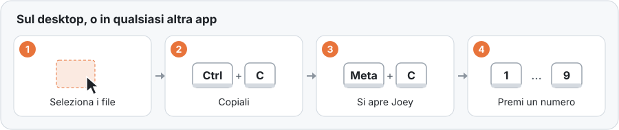

**Sul desktop, o in qualsiasi altro posto:** seleziona i file e copiali con **Ctrl+C**, poi premi **Meta+C** (Meta è il tasto con il logo di Windows, detto anche Super). Joey si apre con i file che hai copiato. Funziona sul desktop di KDE Plasma, in qualsiasi file manager e in qualsiasi app che copia file. L'installazione aggiunge Meta+C su **KDE Plasma** e **GNOME**; sugli altri desktop, assegna a un tasto il comando `joey-gtk --clipboard` nelle impostazioni della tastiera. Sul desktop funziona anche tasto destro → *Joey*.

**Dal menu delle applicazioni:** apri Joey, poi trascina i file sulla finestra o premi *Scegli file…*.

<p align="center">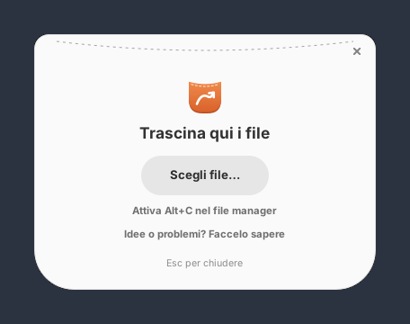</p>

## Installazione

**Il modo semplice:** apri **[outlook791.github.io/Joey](https://outlook791.github.io/Joey/)** e premi **Joey**: Discover o GNOME Software lo installano, e gli aggiornamenti arrivano da soli. Premi anche **Joey Office** se vuoi PowerPoint, e Word ed Excel al meglio (aggiunge LibreOffice, circa 230 MB).

Poi apri Joey dal menu delle applicazioni. La prima volta ti mostra quali tasti lo apriranno: tieni **Alt+C** e **Meta+C**, oppure cliccali per scegliere i tuoi, e premi **Attiva**. Esci e rientra nella sessione una volta e sono pronti. Puoi cambiarli in seguito dalla pagina iniziale di Joey (*Cambia le scorciatoie*).

<p align="center"></p>

Dal terminale, la stessa cosa:

```sh
flatpak install --user https://outlook791.github.io/Joey/joey.flatpakref
flatpak install --user https://outlook791.github.io/Joey/joey-office.flatpakref   # facoltativo
flatpak run io.github.outlook791.Joey --setup-file-managers   # al posto della schermata del primo avvio
```

Gli **aggiornamenti** arrivano da Discover / GNOME Software, oppure con `flatpak update`. **Per togliere Joey:**

```sh
flatpak run io.github.outlook791.Joey --remove-file-managers
flatpak uninstall --user io.github.outlook791.Joey io.github.outlook791.Joey.Office
```

Cosa c'è dentro: FFmpeg, ImageMagick (HEIC, AVIF), Ghostscript, qpdf, libarchive, Pandoc e Typst (Word, ODT, RTF, Markdown, HTML ed EPUB, anche in PDF), openpyxl e xlrd (Excel, ODS e CSV, anche in PDF; tabelle PDF in Excel; PDF in testo). **Joey Office** aggiunge LibreOffice ufficiale, per PowerPoint e per i file Office con l'impaginazione esatta. Senza, Joey usa anche il LibreOffice del tuo computer, se c'è. Funzionano anche KDE Connect, GSConnect, LocalSend e "Apri un terminale qui": per questi il Flatpak avvia i programmi del tuo computer, solo quando li scegli.

### Dal codice sorgente (qualsiasi distribuzione)

Su Fedora:

```sh
sudo dnf install rust cargo gtk4-devel libadwaita-devel \
    ImageMagick poppler-utils img2pdf librsvg2-tools ffmpeg-free qpdf ghostscript \
    libreoffice-writer libreoffice-calc libreoffice-impress libreoffice-pdfimport \
    pandoc bsdtar python3-openpyxl
git clone https://github.com/outlook791/Joey joey && cd joey
./install.sh
```

Sulle altre distribuzioni gli stessi pacchetti hanno altri nomi. Questi comandi vengono verificati automaticamente a ogni modifica:

<details><summary><b>Ubuntu 24.04+ / Debian 13</b></summary>

Il loro Rust è troppo vecchio per le librerie GTK di Rust (serve la 1.92 o successiva), quindi Rust si installa con rustup:

```sh
sudo apt install build-essential pkg-config curl git libgtk-4-dev libadwaita-1-dev \
    imagemagick poppler-utils img2pdf librsvg2-bin ffmpeg qpdf ghostscript \
    libreoffice-writer-nogui libreoffice-calc-nogui libreoffice-impress-nogui \
    pandoc libarchive-tools python3-openpyxl
curl -sSf https://sh.rustup.rs | sh -s -- -y && . "$HOME/.cargo/env"
git clone https://github.com/outlook791/Joey joey && cd joey
./install.sh
```
</details>

<details><summary><b>Arch Linux</b></summary>

```sh
sudo pacman -S --needed base-devel rust gtk4 libadwaita git \
    imagemagick poppler img2pdf librsvg ffmpeg qpdf ghostscript libreoffice-fresh \
    pandoc-cli libarchive python-openpyxl
git clone https://github.com/outlook791/Joey joey && cd joey
./install.sh
```
</details>

<details><summary><b>openSUSE Tumbleweed</b></summary>

```sh
sudo zypper in rust cargo gcc pkgconf gtk4-devel libadwaita-devel git \
    ImageMagick poppler-tools python3-img2pdf rsvg-convert ffmpeg-7 qpdf ghostscript \
    libreoffice-writer libreoffice-calc libreoffice-impress pandoc-cli bsdtar python3-openpyxl
git clone https://github.com/outlook791/Joey joey && cd joey
./install.sh
```
</details>

Poi **esci e rientra nella sessione una volta**, così file manager e desktop caricano le scorciatoie.

`install.sh` compila Joey, lo aggiunge al menu delle applicazioni e configura Alt+C, la voce nel tasto destro e Meta+C nei file manager e nel desktop che trova. Installa solo nella tua cartella home (niente sudo). `./install.sh --uninstall` toglie tutto, scorciatoie comprese.

Per aggiornare: `cd ~/joey && git pull && ./install.sh`.

Joey usa i programmi installati e offre solo quello che sanno fare: senza LibreOffice i file Office passano da Pandoc, Typst e openpyxl (niente PowerPoint); senza FFmpeg niente audio e video. `joey --engines` mostra cosa ha trovato. L'`ffmpeg-free` di Fedora non ha alcuni codec (per esempio l'MP4 H.264 in uscita); l'FFmpeg completo di RPM Fusion li aggiunge. Per l'invio ai dispositivi, associa il telefono in KDE Connect e/o installa LocalSend (`flatpak install flathub org.localsend.localsend_app`).

### Compilare il Flatpak da sé

I manifest sono in [`flatpak/`](flatpak/) (Joey, e Joey Office come estensione). Per compilare e installare Joey:

```sh
sudo dnf install flatpak-builder
flatpak-builder --user --install-deps-from=flathub --force-clean \
    --install build-dir flatpak/io.github.outlook791.Joey.yml
flatpak run io.github.outlook791.Joey --setup-file-managers   # Alt+C, tasto destro, Meta+C
```

Joey Office ha bisogno dell'archivio ufficiale di LibreOffice accanto al suo manifest; [`.github/workflows/checks.yml`](.github/workflows/checks.yml) mostra come le verifiche lo scaricano e lo controllano.

## Convertire

1. Seleziona i file e apri Joey (vedi sopra).
2. Il formato evidenziato è quello che hai scelto l'ultima volta per quel tipo di file. Premi **Invio** per usarlo, oppure il **numero** accanto a un altro formato, oppure cliccalo.

Fatto: il nuovo file compare accanto all'originale, con lo stesso nome e la nuova estensione (`vacanza.jpg` → `vacanza.png`). Joey non sovrascrive mai: se il nome è occupato scrive `vacanza (1).png`. Un PDF trasformato in immagini dà un'immagine per pagina: `scansione-1.png`, `scansione-2.png`… Il peso a destra di ogni formato è una stima del nuovo file.

<p align="center">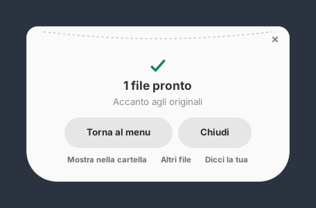</p>

Alla fine Joey si chiude da solo dopo qualche secondo (non se il puntatore è sopra la finestra). Prima puoi premere: **Torna al menu** (o Backspace) per fare altro con gli stessi file, **Altri file**, **Mostra nella cartella**, **Chiudi**.

Cosa può diventare cosa:

| Tipo | Formati |
|---|---|
| Immagini | JPG, PNG, WebP, AVIF, GIF, TIFF, BMP, ICO, HEIC (foto dei telefoni); disegni SVG |
| Audio | MP3, M4A (AAC), OGG, Opus, FLAC, WAV, AIFF, WMA; l'audio di qualsiasi video |
| Video | MP4, MKV, WebM, MOV, AVI, WMV; video in GIF animata e viceversa |
| PDF | pagine in immagini; immagini in PDF; in Word, ODT, PowerPoint, testo, Markdown, EPUB; tabelle in Excel |
| Documenti | Word, ODT, RTF, TXT, Markdown, HTML, EPUB · Excel, ODS, CSV, TSV · PowerPoint, ODP |
| Sottotitoli | SRT, WebVTT, ASS; sottotitoli in testo semplice |
| Archivi | ZIP, TAR, TAR.GZ, 7Z; RAR (solo apertura) |

Joey riconosce i file dal contenuto, non dal nome: un JPG rinominato `.png` resta un JPG. Propone solo conversioni sensate (niente "foto in MP3"). Escluso di proposito: Apple Pages (formato chiuso, senza motori liberi; Word e ODT sono le alternative).

## Più file insieme

Seleziona insieme file di tipi diversi. Ogni tipo ha il suo gruppo, con solo le scelte sensate e il suo numero. Premi i numeri che vuoi, poi **Invio** (o *Converti*). *Altri N…* apre l'elenco completo di un gruppo.

<p align="center">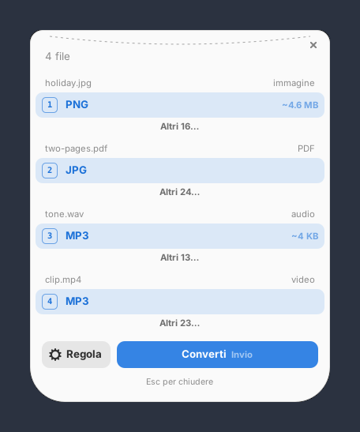</p>

Cartelle e file che Joey non sa convertire hanno comunque le [azioni sui file](#azioni-sui-file).

## Regola: qualità, dimensioni, audio…

Le impostazioni predefinite vanno bene per quasi tutti. Per cambiarle premi **Regola**, oppure **Maiusc+numero** su un formato, oppure **tieni premuto** un formato (mouse o touch).

<p align="center"></p>

Le impostazioni sono a parole e dipendono dal tipo di file: dimensioni (lato più lungo), qualità, togliere i dati di fotocamera e posizione, canali audio, bitrate, frequenza di campionamento, fotogrammi al secondo, tenere o togliere l'audio, pagine e risoluzione del PDF. Quelle meno comuni sono in *Avanzate*. Il peso stimato si aggiorna mentre le cambi. *Ricorda queste impostazioni* le rende predefinite per quel formato; *Ripristina predefiniti* torna indietro.

## Strumenti rapidi

Sotto i formati, Joey propone strumenti che modificano il file senza cambiarne il formato. Il nuovo file ha una nota nel nome, per esempio `vacanza (compressed).jpg`.

| Strumento | Per | Cosa fa |
|---|---|---|
| Comprimi | immagini, video, PDF | File più leggero, stesso formato |
| Rimuovi metadati | immagini, audio, video | Toglie fotocamera, posizione, autore, dati del brano |
| Ruota a sinistra / a destra | immagini, video, PDF | Gira di 90° |
| Bianco e nero | immagini | Scala di grigi |
| Ritaglia in una forma… | immagini | Quadrato, 4:5, 3:2, 4:3, 16:9 o 9:16, tenendo il centro |
| Taglia… | audio, video | Tiene solo da un momento a un altro (es. da 0:30 a 1:45) |
| Uniforma il volume | audio | Stesso volume dall'inizio alla fine |
| Togli l'audio | video | Copia muta del video |
| Dividi in pagine | PDF | Un PDF per pagina |
| Tieni solo alcune pagine… | PDF | es. `1-3, 7` |
| Proteggi con password… | PDF | Serve la password per aprirlo |
| Togli la password… | PDF | Con la password attuale |
| Estrai qui | archivi | Scompatta ZIP, TAR, 7Z, RAR in una cartella |
| Unisci in un solo PDF | 2+ PDF | Un PDF, nell'ordine selezionato |
| Unisci in un'unica traccia | 2+ audio | Un solo file audio |
| Unisci in un solo video | 2+ video | Un solo video |
| Metti in uno ZIP | qualsiasi cosa | Un ZIP con tutto il selezionato |

Gli strumenti con "…" fanno una sola domanda in una piccola schermata, poi partono:

<p align="center"></p>

## Azioni sui file

Per qualsiasi file o cartella, anche quelli che Joey non sa convertire, in fondo all'elenco completo:

| Azione | Cosa fa |
|---|---|
| Copia il percorso | Mette negli appunti il percorso completo dei file |
| Copia in… / Sposta in… | Chiede una cartella; non sovrascrive mai (`nome (1).ext`) |
| Apri un terminale qui | Nella cartella del file |
| Metti in uno ZIP | Un ZIP con tutto il selezionato |
| Invia a *dispositivo* | A un telefono o PC associato con KDE Connect |
| Invia con LocalSend… | Apre LocalSend con i file, pronto per scegliere il dispositivo |

Quando i file passano a un'altra app (terminale, KDE Connect, LocalSend), Joey si chiude da solo.

## Invio al telefono o al PC

L'alternativa gratuita ad AirDrop:

- **KDE Connect** (KDE e altri desktop) o **GSConnect** (la sua versione per GNOME, un'estensione di GNOME Shell): associa una volta il telefono o il PC con l'app KDE Connect sul telefono. Ogni dispositivo associato e raggiungibile compare come *Invia a Pixel 8* (con il suo nome). Il file arriva sul dispositivo; KDE Connect o GSConnect mostrano l'avanzamento.
- **LocalSend**: funziona con Android, iPhone, Windows, Mac e Linux sulla stessa rete Wi-Fi, senza associazione. *Invia con LocalSend…* apre LocalSend con i file già selezionati: lì scegli il dispositivo.

Queste voci compaiono solo quando possono funzionare: un dispositivo solo se è associato e raggiungibile, LocalSend solo se è installato.

## Da PDF a Excel

Seleziona un PDF, apri l'elenco completo (*Altri N…*) e scegli **Excel (XLSX)**. Ogni tabella del PDF diventa un foglio e i numeri restano numeri (si possono sommare). Serve `python3-openpyxl` (più Poppler, che Joey usa comunque). Per tabelle con impaginazioni insolite installa anche pdfplumber (`pip install --user pdfplumber`; su Debian e Ubuntu aggiungi `--break-system-packages`) oppure Camelot: Joey usa il migliore che trova. Funziona sui PDF creati al computer, come fatture ed estratti conto; le pagine scansionate sono immagini senza testo da leggere (errore E108).

<p align="center">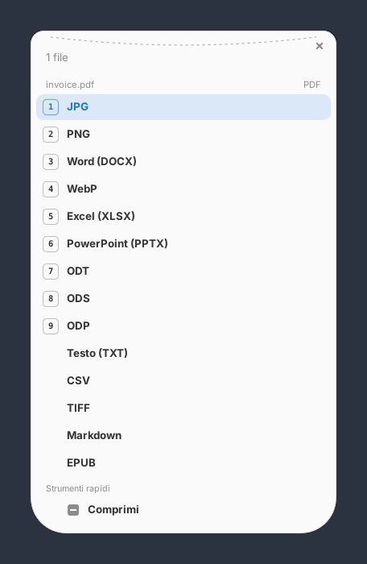</p>

## Tastiera, mouse e touch

Tutto funziona con ognuno dei tre.

| | Tastiera | Mouse | Touch |
|---|---|---|---|
| Scegliere | numero 1–9 | clic | tocco |
| Convertire | Invio | *Converti* | *Converti* |
| Regolare prima | Maiusc+numero | *Regola*, o tieni premuto | tieni premuto, o *Regola* |
| Tornare indietro | Esc (da Regola) · Backspace (dopo la conversione) | *Indietro* · *Torna al menu* | come il mouse |
| Chiudere | Esc | ✕ in alto a destra, o *Chiudi* | ✕ |
| Spostare la finestra | — | trascinala | trascinala |

Sullo schermo touch Joey nasconde i suggerimenti dei tasti e ingrandisce le righe; tornano appena usi tastiera o mouse. `JOEY_TOUCH=1 joey-gtk` parte direttamente in modalità touch (per i tablet).

<p align="center">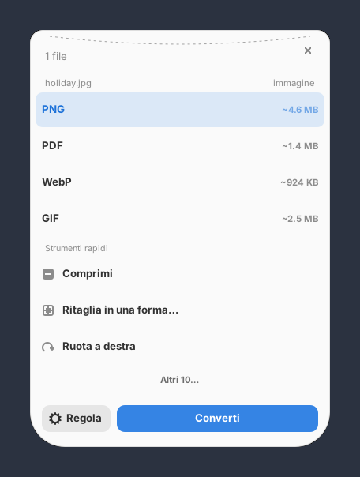 &nbsp; 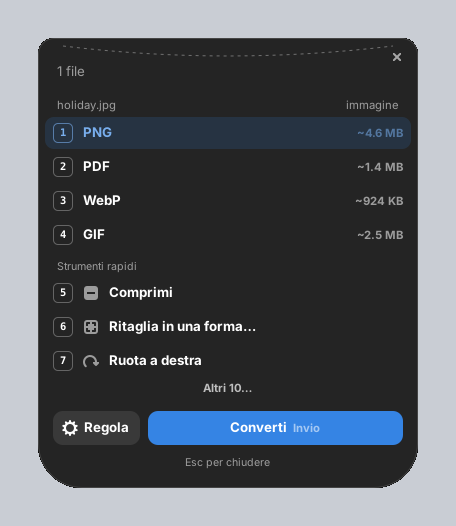</p>

Joey segue il tema chiaro o scuro e il colore di accento del sistema, e parla la lingua del sistema: inglese, cinese (semplificato), hindi, spagnolo, arabo, francese, bengalese, portoghese (Brasile), russo, indonesiano, urdu, tedesco, giapponese, marathi, vietnamita e italiano. Arabo e urdu sono mostrati da destra a sinistra.

Le traduzioni sono state fatte con l'AI e non sono ancora state controllate da madrelingua. Se una parola suona male, [diccelo](#feedback-e-segnalazioni) o correggila direttamente: ogni lingua è un semplice file di testo in [`crates/joey-gtk/i18n/`](crates/joey-gtk/i18n/), una riga per testo (inglese, un tab, la traduzione).

## Quando qualcosa va storto: codici di errore

Ogni problema mostra un codice, cosa significa e cosa fare. Il codice è lo stesso in ogni lingua, così puoi cercarlo o citarlo.

<p align="center">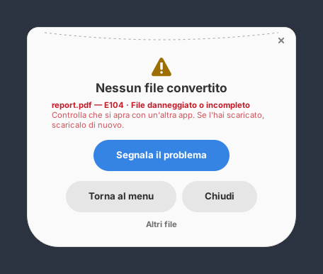</p>

| Codice | Significato | Cosa fare |
|---|---|---|
| E101 | File non trovato | È stato spostato o eliminato dopo averlo selezionato. Selezionalo di nuovo. |
| E102 | Questa è una cartella | Seleziona i file al suo interno, oppure usa Metti in uno ZIP. |
| E103 | Tipo di file non riconosciuto | Il contenuto non è un formato che Joey conosce (legge il contenuto, non il nome). |
| E104 | File danneggiato o incompleto | Controlla che si apra con un'altra app; se l'hai scaricato, scaricalo di nuovo. |
| E105 | File protetto da password | Prima togli la password, poi convertilo. |
| E106 | Password sbagliata | Controlla la password e riprova. |
| E107 | Il file non ha audio | Il video non ha una traccia audio da estrarre. |
| E108 | Nessuna tabella trovata nel PDF | Solo i PDF creati al computer hanno tabelle leggibili; le scansioni sono immagini. |
| E109 | L'archivio è vuoto | Dentro non c'è nulla da estrarre. |
| E110 | Quelle pagine non esistono | Il documento ha meno pagine: controlla i numeri. |
| E111 | È già il più piccolo possibile | Comprimerlo ancora non lo renderebbe più piccolo. |
| E201 | Non possibile su questo computer | Manca un programma che serve a Joey (vedi [Installazione](#installazione)). |
| E202 | Manca un programma che serve a Joey | Installalo, poi riprova. |
| E203 | Il programma installato non gestisce questo formato | Una versione più completa lo aggiunge (es. FFmpeg di RPM Fusion su Fedora). |
| E301 | Il disco è pieno | Libera spazio, o salva altrove. |
| E302 | Joey non ha il permesso di scrivere qui | Copia i file in una tua cartella e convertili lì. |
| E303 | Memoria insufficiente | Chiudi altre app, o converti meno file alla volta. |
| E304 | Bloccato da un limite di sicurezza | L'immagine supera i limiti della politica di sicurezza di ImageMagick. |
| E900 | Errore imprevisto | È un difetto di Joey: segnalalo, per favore. |
| E999 | Il programma di conversione non ce l'ha fatta | Segnalalo: i dettagli ci dicono il perché. |

## Feedback e segnalazioni

- **Qualcosa è andato storto?** Premi *Segnala il problema* nella schermata finale. Joey scrive una segnalazione con quello che serve per correggere il problema: il codice di errore, la versione di Joey, la distribuzione, il desktop, i programmi trovati, la conversione e il comando esatto che ha fallito con il suo messaggio di errore.
- **Joey si è chiuso all'improvviso?** Al riavvio successivo propone di segnalarlo, una volta sola.
- **Un'idea o un'opinione?** *Idee o problemi? Faccelo sapere* nella schermata iniziale, oppure *Dicci la tua* dopo una conversione.

<p align="center">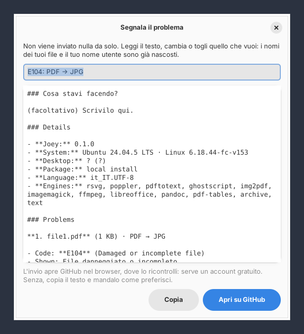</p>

Non viene inviato nulla da solo. Prima ancora che tu veda la segnalazione, i nomi dei tuoi file diventano `file1`, `file2`…, la tua cartella home `~` e il tuo nome utente `user`. Puoi leggere e cambiare tutto, poi **Apri su GitHub** (si apre una nuova segnalazione nel browser, già compilata; serve un account GitHub gratuito) oppure **Copia** e mandala come preferisci. Il comando `joey` stampa gli stessi dettagli quando una conversione fallisce.

## Usare Joey da un'AI

Joey non contiene un'AI, ma qualsiasi app di AI che supporta il **Model Context Protocol** (MCP) può usarlo: chiedi "trasforma queste foto in un unico PDF" o "metti in Excel le tabelle di questa fattura" e l'AI richiama Joey sul tuo computer. Funziona sia con modelli online sia locali, nelle app MCP come Claude Code, Gemini CLI, LM Studio, Goose o Cursor.

Aggiungi Joey ai server MCP della tua app di AI. Quasi tutte usano questo formato:

```json
{
  "mcpServers": {
    "joey": { "command": "joey", "args": ["--mcp"] }
  }
}
```

Con il Flatpak: `"command": "flatpak", "args": ["run", "--command=joey", "io.github.outlook791.Joey", "--mcp"]`. In Claude Code: `claude mcp add joey -- joey --mcp`.

L'AI riceve quattro strumenti: `joey_inspect` (cos'è un file e cosa può diventare), `joey_convert` (con le stesse impostazioni di Regola), `joey_tool` (gli strumenti rapidi) e `joey_engines`. Valgono le stesse regole che valgono per te: i risultati vanno accanto agli originali (o in una cartella scelta), nulla viene sovrascritto o eliminato, e gli errori arrivano con il loro codice e cosa fare.

## Riga di comando

```sh
joey foto.heic --to jpg            # un file
joey *.png --to webp               # tanti file, in parallelo
joey scansione.pdf --to png        # ogni pagina → scansione-1.png, scansione-2.png…
joey report.pdf --to png -o out/   # risultati in un'altra cartella
joey --targets foto.heic           # cosa può diventare questo file?
joey --engines                     # quali programmi ha trovato
joey --mcp                         # al servizio delle app di AI (vedi sopra)

joey-gtk FILE…                     # apre la finestra con questi file
joey-gtk --clipboard               # la apre con gli ultimi file copiati
joey-gtk --setup-file-managers     # rimette scorciatoie e tasto destro (tasti salvati)
joey-gtk --remove-file-managers    # li toglie
```

## Problemi comuni

- **Alt+C non fa nulla nel file manager:** esci e rientra nella sessione dopo l'installazione. Dolphin deve essere alla versione 26.04 o successiva (`dolphin --version`); in quelle precedenti usa tasto destro → *Joey* o Meta+C. Controlla che Alt+C non sia assegnato ad altro nelle scorciatoie del file manager.
- **Meta+C non fa nulla:** prima copia i file con Ctrl+C, poi esci e rientra nella sessione una volta. Un'altra app potrebbe usare già gli stessi tasti: scegline altri dalla pagina iniziale di Joey (*Cambia le scorciatoie*).
- **L'icona è un punto interrogativo:** esci e rientra; se resta, rilancia `./install.sh` (o reinstalla il Flatpak).
- **Niente PowerPoint, o Word/Excel con impaginazione semplice:** installa Joey Office (vedi [Installazione](#installazione)) o LibreOffice.
- **Manca un formato:** `joey --engines` mostra quali programmi ha trovato Joey. Installa quello che manca (vedi [Installazione](#installazione)) e il formato compare.
- **Altro:** [segnalalo](#feedback-e-segnalazioni); la segnalazione dice cosa serve.

## Come è fatto Joey

Joey è scritto con un assistente AI (Claude, di Anthropic), guidato, provato e mantenuto dal suo autore, outlook791. Quasi tutto il codice, il pacchetto Flatpak, queste guide e le traduzioni sono stati generati dall'AI a partire dalle sue richieste. Ogni modifica viene verificata automaticamente su cinque distribuzioni, e l'autore lo prova su Fedora KDE. Se qualcosa non funziona, [segnalalo](#feedback-e-segnalazioni).

## Licenza

GPL-3.0 o successiva. Vedi [LICENSE](LICENSE).
