# Joey

**Converts files. That's it, really.**

🇮🇹 [Leggi in italiano](README.it.md)

Joey is a free, open-source file converter for Linux. Select files, press a key, pick a format: done. The result lands next to the original, which is never touched. Everything happens on your computer; nothing is uploaded.

<p align="center">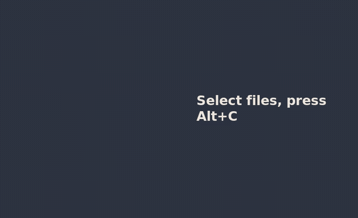</p>

> Status: current version (26.10.3). It works end to end; polish comes next.
>
> **Made with AI:** Joey is written with an AI assistant. See [How Joey is made](#how-joey-is-made).
>
> Versions are numbered by date: **year.month.release of that month** (26.10.2 is the second release of October 2026). There's no fixed schedule: updates come out when they're needed.

**Contents:** [Two ways to open it](#two-ways-to-open-joey) · [Install](#install) · [Converting](#converting) · [Several files](#several-files-at-once) · [Adjust](#adjust-quality-size-sound) · [Quick tools](#quick-tools) · [File actions](#file-actions) · [Send to phone or PC](#send-to-your-phone-or-pc) · [PDF to Excel](#pdf-to-excel) · [Keyboard, mouse, touch](#keyboard-mouse-and-touch) · [Error codes](#when-something-goes-wrong-error-codes) · [Feedback](#feedback-and-problem-reports) · [Use Joey from an AI](#use-joey-from-an-ai) · [Command line](#the-command-line) · [Troubleshooting](#troubleshooting)

## Two ways to open Joey

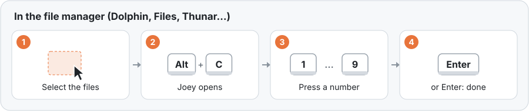

**In the file manager:** select the files, press **Alt+C** (or right-click → *Joey*), then press a number. Alt+C works in **Dolphin** 26.04+ (KDE), **Files/Nautilus** (GNOME) and **Thunar** (Xfce). **Nemo** (Cinnamon), **Caja** (MATE), **PCManFM** and **PCManFM-Qt** (LXDE/LXQt) get the right-click entry.

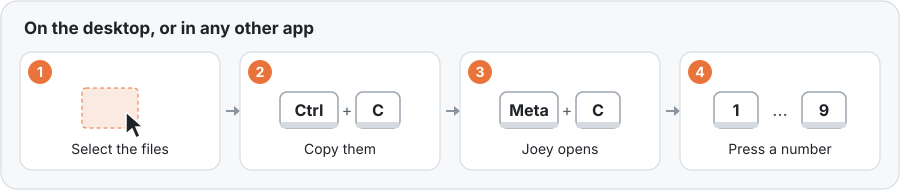

**On the desktop, or anywhere else:** select the files and copy them with **Ctrl+C**, then press **Meta+C** (Meta is the key with the Windows logo, also called Super). Joey opens with the files you copied. It works on the KDE Plasma desktop, in any file manager and in any app that copies files. The setup adds Meta+C on **KDE Plasma** and **GNOME**; on other desktops, bind the command `joey-gtk --clipboard` to a key in the keyboard settings. On the desktop, right-click → *Joey* works too.

**From the app menu:** open Joey, then drop files on it or press *Choose files…*.

<p align="center">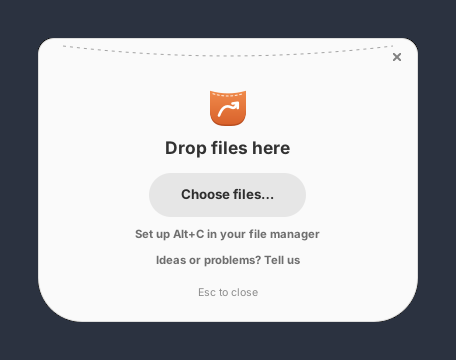</p>

## Install

**The easy way:** open **[outlook791.github.io/Joey](https://outlook791.github.io/Joey/)** and press **Joey**: Discover or GNOME Software install it, and updates arrive by themselves. Press **Joey Office** too if you want PowerPoint, and Word and Excel at their best (it adds LibreOffice, about 230 MB).

Then open Joey from the app menu. The first time, it shows which keys will open it: keep **Alt+C** and **Meta+C**, or click them to choose your own, and press **Turn on**. Log out and back in once, and they're ready. You can change them later from Joey's start page (*Change the shortcuts*).

<p align="center">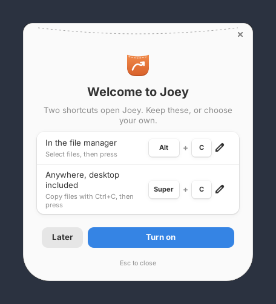</p>

From a terminal, the same thing:

```sh
flatpak install --user https://outlook791.github.io/Joey/joey.flatpakref
flatpak install --user https://outlook791.github.io/Joey/joey-office.flatpakref   # optional
flatpak run io.github.outlook791.Joey --setup-file-managers   # instead of the first-start screen
```

**Updates** come through Discover / GNOME Software, or `flatpak update`. **To remove Joey:**

```sh
flatpak run io.github.outlook791.Joey --remove-file-managers
flatpak uninstall --user io.github.outlook791.Joey io.github.outlook791.Joey.Office
```

What's inside: FFmpeg, ImageMagick (HEIC, AVIF), Ghostscript, qpdf, libarchive, Pandoc and Typst (Word, ODT, RTF, Markdown, HTML and EPUB, also to PDF), openpyxl and xlrd (Excel, ODS and CSV, also to PDF; PDF tables to Excel; PDF to text). **Joey Office** adds the official LibreOffice build, for PowerPoint and for Office files with their exact layout. Without it, Joey also uses LibreOffice if it's on your computer. KDE Connect, GSConnect, LocalSend and "Open a terminal here" work too: for these the Flatpak starts the programs on your computer, only when you choose them.

### From source (any distribution)

On Fedora:

```sh
sudo dnf install rust cargo gtk4-devel libadwaita-devel \
    ImageMagick poppler-utils img2pdf librsvg2-tools ffmpeg-free qpdf ghostscript \
    libreoffice-writer libreoffice-calc libreoffice-impress libreoffice-pdfimport \
    pandoc bsdtar python3-openpyxl
git clone https://github.com/outlook791/Joey joey && cd joey
./install.sh
```

On other distributions, the same packages have other names. These commands are checked automatically on every change:

<details><summary><b>Ubuntu 24.04+ / Debian 13</b></summary>

Their own Rust is too old for GTK's Rust bindings (1.92 or newer is needed), so Rust comes from rustup:

```sh
sudo apt install build-essential pkg-config curl git libgtk-4-dev libadwaita-1-dev \
    imagemagick poppler-utils img2pdf librsvg2-bin ffmpeg qpdf ghostscript \
    libreoffice-writer-nogui libreoffice-calc-nogui libreoffice-impress-nogui \
    pandoc libarchive-tools python3-openpyxl
curl -sSf https://sh.rustup.rs | sh -s -- -y && . "$HOME/.cargo/env"
git clone https://github.com/outlook791/Joey joey && cd joey
./install.sh
```
</details>

<details><summary><b>Arch Linux</b></summary>

```sh
sudo pacman -S --needed base-devel rust gtk4 libadwaita git \
    imagemagick poppler img2pdf librsvg ffmpeg qpdf ghostscript libreoffice-fresh \
    pandoc-cli libarchive python-openpyxl
git clone https://github.com/outlook791/Joey joey && cd joey
./install.sh
```
</details>

<details><summary><b>openSUSE Tumbleweed</b></summary>

```sh
sudo zypper in rust cargo gcc pkgconf gtk4-devel libadwaita-devel git \
    ImageMagick poppler-tools python3-img2pdf rsvg-convert ffmpeg-7 qpdf ghostscript \
    libreoffice-writer libreoffice-calc libreoffice-impress pandoc-cli bsdtar python3-openpyxl
git clone https://github.com/outlook791/Joey joey && cd joey
./install.sh
```
</details>

Then **log out and back in once**, so the file manager and the desktop pick up the shortcuts.

`install.sh` builds Joey, adds it to the app menu and sets up Alt+C, the right-click entry and Meta+C for the file managers and desktop it finds. It installs only in your home folder (no sudo). `./install.sh --uninstall` removes everything, shortcuts included.

To update: `cd ~/joey && git pull && ./install.sh`.

Joey uses whatever programs are installed and only offers what they can do: without LibreOffice, Office files go through Pandoc, Typst and openpyxl (no PowerPoint); without FFmpeg there's no audio or video. `joey --engines` shows what it found. Fedora's `ffmpeg-free` lacks some codecs (e.g. H.264 MP4 output); the full FFmpeg from RPM Fusion covers them. For sending to devices, pair your phone in KDE Connect and/or install LocalSend (`flatpak install flathub org.localsend.localsend_app`).

### Build the Flatpak yourself

The manifests are in [`flatpak/`](flatpak/) (Joey, and Joey Office as an add-on). To build and install Joey locally:

```sh
sudo dnf install flatpak-builder
flatpak-builder --user --install-deps-from=flathub --force-clean \
    --install build-dir flatpak/io.github.outlook791.Joey.yml
flatpak run io.github.outlook791.Joey --setup-file-managers   # Alt+C, right-click, Meta+C
```

Joey Office needs the official LibreOffice archive next to its manifest; [`.github/workflows/checks.yml`](.github/workflows/checks.yml) shows how the checks download and verify it.

## Converting

1. Select the files and open Joey (see above).
2. The highlighted format is the one you chose last time for that kind of file. Press **Enter** to use it, or the **number** next to another format, or click it.

That's all: the new file appears next to the original, with the same name and the new extension (`holiday.jpg` → `holiday.png`). Joey never overwrites: if the name is taken, it writes `holiday (1).png`. A PDF turned into images gives one image per page: `scan-1.png`, `scan-2.png`… The size on the right of each format is an estimate of the new file.

<p align="center">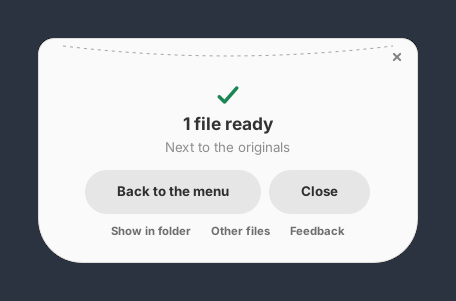</p>

When it's done, Joey closes by itself after a few seconds (not while the pointer is on it). Before that: **Back to the menu** (or Backspace) to do something else with the same files, **Other files**, **Show in folder**, **Close**.

What can become what:

| Kind | Formats |
|---|---|
| Images | JPG, PNG, WebP, AVIF, GIF, TIFF, BMP, ICO, HEIC (phone photos); SVG drawings |
| Audio | MP3, M4A (AAC), OGG, Opus, FLAC, WAV, AIFF, WMA; the sound of any video |
| Video | MP4, MKV, WebM, MOV, AVI, WMV; video to animated GIF and back |
| PDF | pages to images; images to PDF; to Word, ODT, PowerPoint, text, Markdown, EPUB; tables to Excel |
| Documents | Word, ODT, RTF, TXT, Markdown, HTML, EPUB · Excel, ODS, CSV, TSV · PowerPoint, ODP |
| Subtitles | SRT, WebVTT, ASS; subtitles to plain text |
| Archives | ZIP, TAR, TAR.GZ, 7Z; RAR (opening only) |

Joey recognises files by their content, not by their name: a JPG renamed `.png` is still treated as a JPG. It only offers conversions a person would want (no "photo to MP3"). Not included, on purpose: Apple Pages (closed format, no free engine; Word and ODT are the alternatives).

## Several files at once

Select files of different kinds together. Each kind gets its own group with only the choices that make sense for it, and its own number. Press the numbers you want, then **Enter** (or *Convert*). *N more…* opens the full list for a group.

<p align="center">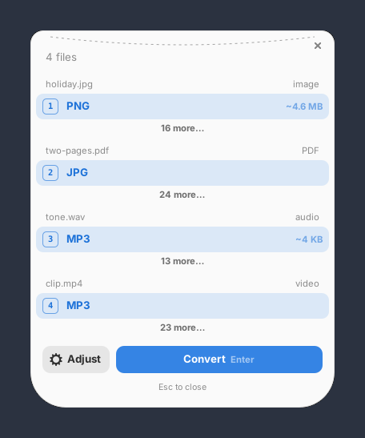</p>

Folders and files Joey can't convert still get the [file actions](#file-actions).

## Adjust: quality, size, sound…

The defaults suit most people. To change them, press **Adjust**, or **Shift+number** on a format, or **press and hold** a format (mouse or touch).

<p align="center">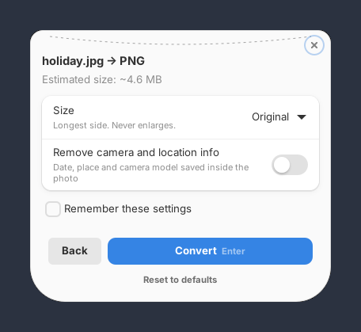</p>

The settings are in plain words and depend on the kind of file: size (longest side), quality, removing camera and location info, sound channels, bitrate, sample rate, frames per second, keeping or removing the sound, PDF pages and resolution. The less common ones are under *Advanced*. The estimated size updates as you change them. *Remember these settings* makes them the default for that format; *Reset to defaults* goes back.

## Quick tools

Below the formats, Joey offers tools that change a file without changing its format. The new file gets a note in its name, e.g. `holiday (compressed).jpg`.

| Tool | For | What it does |
|---|---|---|
| Compress | images, video, PDF | Smaller file, same format |
| Remove metadata | images, audio, video | Removes camera, location, author, song tags |
| Rotate left / right | images, video, PDF | Turns it by 90° |
| Black and white | images | Grayscale |
| Crop to a shape… | images | Square, 4:5, 3:2, 4:3, 16:9 or 9:16, keeping the middle |
| Trim… | audio, video | Keeps only from one time to another (e.g. 0:30 to 1:45) |
| Even out the volume | audio | Same loudness throughout |
| Remove the sound | video | Silent copy of the video |
| Split into pages | PDF | One PDF per page |
| Keep only some pages… | PDF | e.g. `1-3, 7` |
| Protect with a password… | PDF | Needs the password to open |
| Remove the password… | PDF | With the current password |
| Extract here | archives | Unpacks ZIP, TAR, 7Z, RAR into a folder |
| Merge into one PDF | 2+ PDFs | One PDF, in the order selected |
| Join into one track | 2+ audio files | One audio file |
| Join into one video | 2+ videos | One video |
| Put in a ZIP | anything | One ZIP with everything selected |

Tools marked "…" ask one question on a small screen, then run:

<p align="center">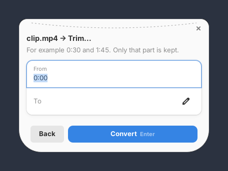</p>

## File actions

For any file or folder, even ones Joey can't convert, at the bottom of the full list:

| Action | What it does |
|---|---|
| Copy the path | Puts the full path of the files on the clipboard |
| Copy to… / Move to… | Asks for a folder; never overwrites (`name (1).ext`) |
| Open a terminal here | In the folder of the file |
| Put in a ZIP | One ZIP with everything selected |
| Send to *device* | To a phone or PC paired with KDE Connect |
| Send with LocalSend… | Opens LocalSend with the files, ready to pick a device |

When the files go on to another app (terminal, KDE Connect, LocalSend), Joey closes by itself.

## Send to your phone or PC

The free alternative to AirDrop:

- **KDE Connect** (KDE and other desktops) or **GSConnect** (its GNOME version, a GNOME Shell extension): pair your phone or PC once in the KDE Connect app on the phone. Each paired device that is reachable appears as *Send to Pixel 8* (with its name). The file arrives on the device; KDE Connect or GSConnect shows the progress.
- **LocalSend**: works with Android, iPhone, Windows, Mac and Linux on the same Wi-Fi, without pairing. *Send with LocalSend…* opens LocalSend with your files already selected: pick the device there.

These entries appear only when they can work: a device only while it's paired and reachable, LocalSend only if it's installed.

## PDF to Excel

Select a PDF, open the full list (*N more…*) and choose **Excel (XLSX)**. Each table in the PDF becomes a sheet, and numbers stay numbers (they can be summed). It needs `python3-openpyxl` (and Poppler, which Joey uses anyway). For tables with unusual layouts, install pdfplumber too (`pip install --user pdfplumber`; on Debian and Ubuntu add `--break-system-packages`), or Camelot: Joey uses the best one it finds. It works on PDFs made by a computer, like invoices and statements; scanned pages are pictures with no text to read (error E108).

<p align="center">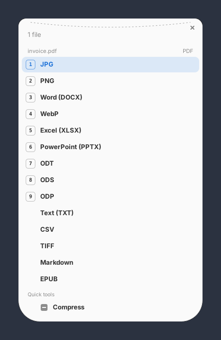</p>

## Keyboard, mouse and touch

Everything works with any of the three.

| | Keyboard | Mouse | Touch |
|---|---|---|---|
| Choose | number 1–9 | click | tap |
| Convert | Enter | *Convert* | *Convert* |
| Adjust first | Shift+number | *Adjust*, or press and hold | press and hold, or *Adjust* |
| Back | Esc (from Adjust) · Backspace (after converting) | *Back* · *Back to the menu* | same as mouse |
| Close | Esc | ✕ at the top right, or *Close* | ✕ |
| Move the window | — | drag it | drag it |

On a touch screen Joey hides the keyboard hints and makes the rows bigger; they come back as soon as you use the keyboard or a mouse. `JOEY_TOUCH=1 joey-gtk` starts directly in touch mode (for tablets).

<p align="center">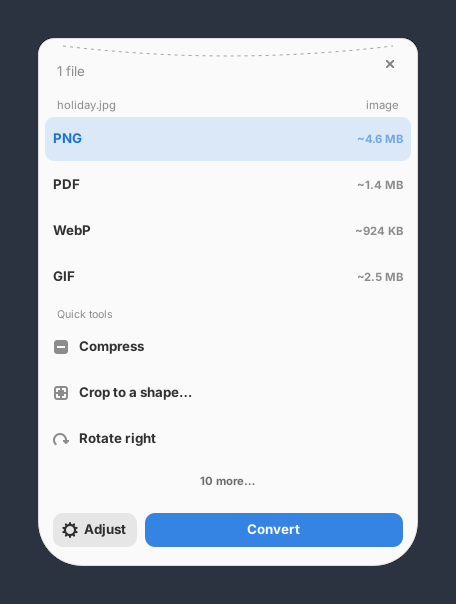 &nbsp; 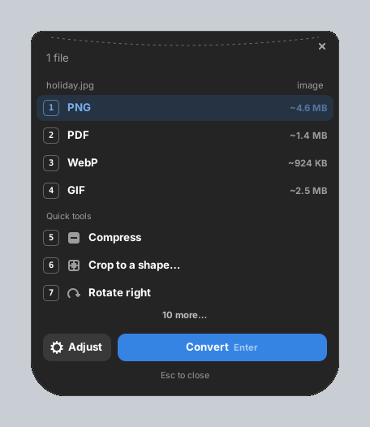</p>

Joey follows the system's light or dark theme and accent colour, and speaks your system language (English and Italian for now).

## When something goes wrong: error codes

Each problem shows a code, what it means and what to do. The code is the same in every language, so you can search for it or quote it.

<p align="center">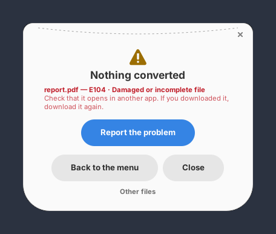</p>

| Code | Meaning | What to do |
|---|---|---|
| E101 | File not found | It was moved or deleted after you selected it. Select it again. |
| E102 | This is a folder | Select the files inside it, or use Put in a ZIP. |
| E103 | File type not recognised | The content isn't a format Joey knows (it reads the content, not the name). |
| E104 | Damaged or incomplete file | Check that it opens in another app; if downloaded, download it again. |
| E105 | Protected by a password | Remove the password first, then convert it. |
| E106 | Wrong password | Check the password and try again. |
| E107 | The file has no sound | The video has no audio track to extract. |
| E108 | No tables found in the PDF | Only PDFs made by a computer have readable tables; scans are pictures. |
| E109 | The archive is empty | Nothing inside to extract. |
| E110 | Those pages don't exist | The document has fewer pages: check the numbers. |
| E111 | Already as small as it gets | Compressing more wouldn't make it smaller. |
| E201 | Not possible on this computer | A program Joey needs isn't installed (see [Install](#install)). |
| E202 | A program Joey needs is missing | Install it, then try again. |
| E203 | The installed program can't handle this format | A fuller version adds it (e.g. FFmpeg from RPM Fusion on Fedora). |
| E301 | The disk is full | Free some space, or save elsewhere. |
| E302 | Joey isn't allowed to write here | Copy the files to one of your folders and convert them there. |
| E303 | Not enough memory | Close other apps, or convert fewer files at a time. |
| E304 | Blocked by a safety limit | The image exceeds ImageMagick's security policy limits. |
| E900 | Unexpected error | A bug in Joey: please report it. |
| E999 | The conversion program failed | Please report it: the details tell us why. |

## Feedback and problem reports

- **Something went wrong?** Press *Report the problem* on the result screen. Joey writes a report with what's needed to fix it: the error code, Joey's version, distribution, desktop, which programs it found, the conversion, and the exact command that failed with its error output.
- **Joey closed unexpectedly?** At the next start it offers to report it, once.
- **An idea or an opinion?** *Ideas or problems? Tell us* on the start screen, or *Feedback* after a conversion.

<p align="center">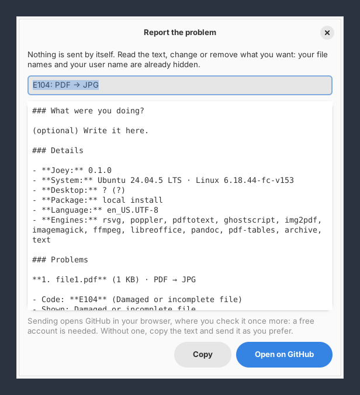</p>

Nothing is ever sent by itself. Before you even see the report, your file names become `file1`, `file2`…, your home folder `~` and your user name `user`. You can read and change everything, then **Open on GitHub** (a new issue opens in your browser, already filled in; a free GitHub account is needed) or **Copy** it and send it as you prefer. The `joey` command prints the same details when a conversion fails.

## Use Joey from an AI

Joey doesn't contain an AI, but any AI app that supports the **Model Context Protocol** (MCP) can use it: ask "turn these photos into one PDF" or "put the tables of this invoice in Excel", and the AI calls Joey on your computer. It works with online and local models alike, in MCP apps such as Claude Code, Gemini CLI, LM Studio, Goose or Cursor.

Add Joey to your AI app's MCP servers. Most use this format:

```json
{
  "mcpServers": {
    "joey": { "command": "joey", "args": ["--mcp"] }
  }
}
```

With the Flatpak: `"command": "flatpak", "args": ["run", "--command=joey", "io.github.outlook791.Joey", "--mcp"]`. In Claude Code: `claude mcp add joey -- joey --mcp`.

The AI gets four tools: `joey_inspect` (what a file is and what it can become), `joey_convert` (with the same settings as Adjust), `joey_tool` (the quick tools) and `joey_engines`. The same rules apply as for you: results go next to the originals (or in a chosen folder), nothing is overwritten or deleted, and errors come with their code and what to do.

## The command line

```sh
joey photo.heic --to jpg           # one file
joey *.png --to webp               # many files, in parallel
joey scan.pdf --to png             # every page → scan-1.png, scan-2.png…
joey report.pdf --to png -o out/   # results in another folder
joey --targets photo.heic          # what can this file become?
joey --engines                     # which programs were found
joey --mcp                         # serve AI apps (see above)

joey-gtk FILE…                     # open the window with these files
joey-gtk --clipboard               # open it with the files last copied
joey-gtk --setup-file-managers     # add the shortcuts and right-click again (saved keys)
joey-gtk --remove-file-managers    # take them out
```

## Troubleshooting

- **Alt+C does nothing in the file manager:** log out and back in after installing. Dolphin needs version 26.04 or newer (`dolphin --version`); in older ones use right-click → *Joey* or Meta+C. Check that Alt+C isn't assigned to something else in the file manager's shortcut settings.
- **Meta+C does nothing:** copy the files with Ctrl+C first, then log out and back in once. Another app may already use the same keys: choose others on Joey's start page (*Change the shortcuts*).
- **The icon is a question mark:** log out and back in; if it stays, run `./install.sh` again (or reinstall the Flatpak).
- **No PowerPoint, or Word/Excel layouts look plain:** install Joey Office (see [Install](#install)) or LibreOffice.
- **A format is missing:** `joey --engines` shows which programs Joey found. Install the missing one (see [Install](#install)) and it appears.
- **Anything else:** [report it](#feedback-and-problem-reports); the report says what's needed.

## How it works

1. **Recognises** each file by its content, not its extension.
2. **Finds a route** in a graph of conversions, chaining up to three steps when no program converts directly (WebP → PNG → PDF, DOCX → PDF → PNG), and offers only conversions a person would want.
3. **Drives proven programs**: ImageMagick, FFmpeg, LibreOffice, Pandoc, Poppler, Ghostscript, img2pdf, librsvg, qpdf, libarchive, openpyxl (with pdfplumber or Camelot if installed). If one fails on a step, it tries the next able to do it. Settings apply on the last step only, so intermediate steps lose nothing.

## Project layout

```
crates/joey-core   the engine: detection, conversion graph, settings, tools, error codes, diagnostics
crates/joey-cli    the `joey` command and the MCP server for AI apps
crates/joey-gtk    the window (GTK 4 + libadwaita), Adjust, feedback, file manager setup
data/              menu entry, icons, store metadata
docs/              screenshots and diagrams for this guide
flatpak/           Flatpak manifest and offline Rust sources
```

Run the tests with `cargo test`. Conversions the installed programs can't do are reported as skipped.

Every change is checked automatically on GitHub ([Checks](.github/workflows/checks.yml)): Joey is built and tested on Fedora, Ubuntu 24.04, Debian 13, Arch Linux and openSUSE Tumbleweed, including the command line, the AI server, the window and `install.sh`; the code style and store metadata are checked; the Flatpak and Joey Office are built, installed and used to convert files (Word, Excel, PowerPoint, PDF, images). When everything passes on `main`, the signed repository is published on [outlook791.github.io/Joey](https://outlook791.github.io/Joey/). Each run's Flatpak files can also be downloaded from its *Artifacts*. `ci/check.sh` runs the same checks on your computer.

## How Joey is made

Joey is written with an AI assistant (Claude, by Anthropic), directed, tried and maintained by its author, outlook791. Nearly all of the code, the packaging and these guides were generated by the AI from his requests. Every change is checked automatically on five distributions (see above), and the author tries it on Fedora KDE. If something doesn't work, please [report it](#feedback-and-problem-reports).

## License

GPL-3.0-or-later. See [LICENSE](LICENSE).
